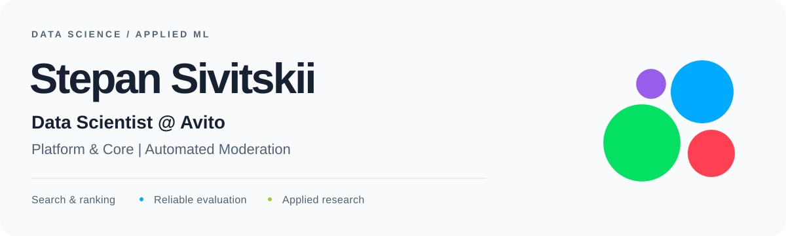
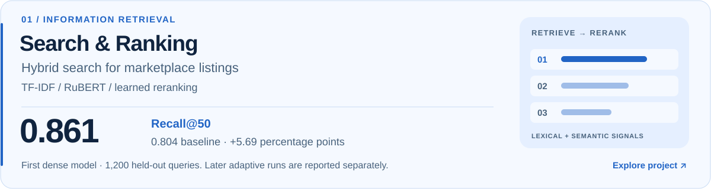
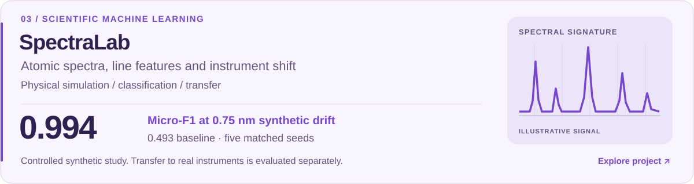
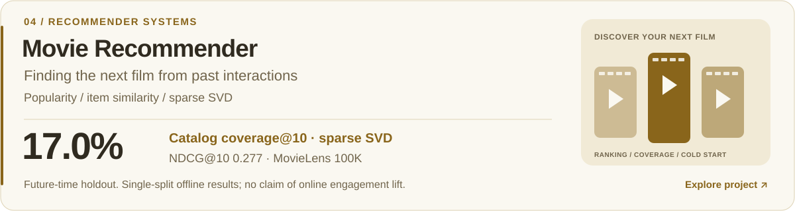
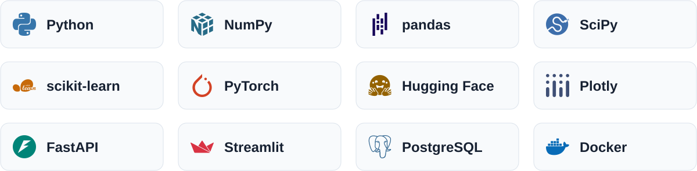

<picture>
  <source media="(prefers-color-scheme: dark)" srcset="assets/header-dark.svg">
  <source media="(prefers-color-scheme: light)" srcset="assets/header-light.svg">
  
</picture>

  <a href="#user-content-about">About</a> &nbsp;·&nbsp;
  <a href="#user-content-current-focus">Focus</a> &nbsp;·&nbsp;
  <a href="#user-content-selected-work">Projects</a> &nbsp;·&nbsp;
  <a href="#user-content-open-source">Open source</a> &nbsp;·&nbsp;
  <a href="#user-content-mlds-stack">Stack</a> &nbsp;·&nbsp;
  <a href="#user-content-contact">Contact</a>

## About

I work as a **Data Scientist at Avito**, in **Platform & Core | Automated Moderation**.
My public projects explore search, ranking, classification and scientific ML — with
an emphasis on meaningful baselines, careful validation and understanding model failures.

Previously **ML Developer Intern at Yandex · International Search**, working on
RAG/LLM experiments and evaluation. **ITMO University**, BSc 2024–2028 (expected).

## Current focus

<picture>
  <source media="(max-width: 600px) and (prefers-color-scheme: dark)" srcset="assets/focus/dark-mobile.svg">
  <source media="(max-width: 600px)" srcset="assets/focus/light-mobile.svg">
  <source media="(prefers-color-scheme: dark)" srcset="assets/focus/dark.svg">
  
</picture>

## Selected work

<a href="https://github.com/ssivitskii/ds-bootcamp-avito">
  <picture>
    <source media="(max-width: 600px) and (prefers-color-scheme: dark)" srcset="assets/projects/search-dark-mobile.svg">
    <source media="(max-width: 600px)" srcset="assets/projects/search-light-mobile.svg">
    <source media="(prefers-color-scheme: dark)" srcset="assets/projects/search-dark.svg">
    
  </picture>
</a>

<a href="https://github.com/ssivitskii/FraudGuard">
  <picture>
    <source media="(max-width: 600px) and (prefers-color-scheme: dark)" srcset="https://raw.githubusercontent.com/ssivitskii/ssivitskii/3069b01207f59c029362dc8cbac5a33532bd28a6/assets/projects/fraud-dark-mobile.svg">
    <source media="(max-width: 600px)" srcset="https://raw.githubusercontent.com/ssivitskii/ssivitskii/3069b01207f59c029362dc8cbac5a33532bd28a6/assets/projects/fraud-light-mobile.svg">
    <source media="(prefers-color-scheme: dark)" srcset="https://raw.githubusercontent.com/ssivitskii/ssivitskii/3069b01207f59c029362dc8cbac5a33532bd28a6/assets/projects/fraud-dark.svg">
    
  </picture>
</a>

<a href="https://github.com/ssivitskii/SpectraLab">
  <picture>
    <source media="(max-width: 600px) and (prefers-color-scheme: dark)" srcset="assets/projects/spectra-dark-mobile.svg">
    <source media="(max-width: 600px)" srcset="assets/projects/spectra-light-mobile.svg">
    <source media="(prefers-color-scheme: dark)" srcset="assets/projects/spectra-dark.svg">
    
  </picture>
</a>

<a href="https://github.com/ssivitskii/Movie-Recommender">
  <picture>
    <source media="(max-width: 600px) and (prefers-color-scheme: dark)" srcset="assets/projects/movies-dark-mobile.svg">
    <source media="(max-width: 600px)" srcset="assets/projects/movies-light-mobile.svg">
    <source media="(prefers-color-scheme: dark)" srcset="assets/projects/movies-dark.svg">
    
  </picture>
</a>

Evaluation details: [Search & Ranking](https://github.com/ssivitskii/ds-bootcamp-avito/blob/main/docs/experiment-log.md) · [FraudGuard · Elliptic](https://github.com/ssivitskii/FraudGuard/blob/main/reports/elliptic.json) · [SpectraLab](https://github.com/ssivitskii/SpectraLab/blob/main/docs/line_classifier_v1.md) · [Movie Recommender](https://github.com/ssivitskii/Movie-Recommender/blob/main/reports/temporal_ml100k.json).

**More experiments** · [ExperimentLab](https://github.com/ssivitskii/experiment-lab)
— causal inference and uplift; exploratory Criteo pilot ·
[Code Review Evals](https://github.com/ssivitskii/code-review-evals)
— executable fixtures and LLM evaluation; live model benchmark pending ·
[VibroLab](https://github.com/ssivitskii/VibroLab)
— vibration classification under operating-condition shift.

## Open source

[DoubleML #422](https://github.com/DoubleML/doubleml-for-py/pull/422)
— fixed cluster fold counts with externally supplied sample splits.
**Merged on October 30, 2026.**

## ML/DS stack

<picture>
  <source media="(max-width: 600px) and (prefers-color-scheme: dark)" srcset="assets/stack/dark-mobile.svg">
  <source media="(max-width: 600px)" srcset="assets/stack/light-mobile.svg">
  <source media="(prefers-color-scheme: dark)" srcset="assets/stack/dark.svg">
  
</picture>

**NLP** · Transformers · Sentence Transformers. 
**Visualization** · Matplotlib · Seaborn. 
**Development** · Git · GitHub Actions · pytest.

Public projects are personal work. Reported results belong to the linked datasets and evaluation protocols.

## Contributions

<picture>
  <source media="(prefers-color-scheme: dark)" srcset="https://raw.githubusercontent.com/ssivitskii/ssivitskii/output/github-snake-dark.svg">
  <source media="(prefers-color-scheme: light)" srcset="https://raw.githubusercontent.com/ssivitskii/ssivitskii/output/github-snake.svg">
  
</picture>

Updated daily · <a href="https://github.com/Platane/snk">Snake animation by Platane</a>

## Contact

<a href="mailto:ssivitskii@outlook.com">
  <picture>
    <source media="(max-width: 600px) and (prefers-color-scheme: dark)" srcset="assets/contact/dark-mobile.svg">
    <source media="(max-width: 600px)" srcset="assets/contact/light-mobile.svg">
    <source media="(prefers-color-scheme: dark)" srcset="assets/contact/dark.svg">
    
  </picture>
</a>

  <a href="mailto:ssivitskii@outlook.com">Email</a> &nbsp;·&nbsp;
  <a href="https://t.me/ssivitskii">Telegram</a> &nbsp;·&nbsp;
  <a href="https://www.linkedin.com/in/ssivitskiy">LinkedIn</a>

<a href="#user-content-top">Back to top ↑</a>

